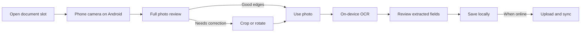

# Camera capture to crop: A-to-Z architecture

Updated 21 November 2026. Scope: onboarding document and profile photo capture on Android and web.

## Problem seen on the SM-M075F

The supplied screen shows a dark viewfinder with many controls around a small ID-card frame. A user has to manage zoom, focus, shutter, framing, crop, and OCR in one flow. The image alone does not prove why the preview is dark; camera frames, permission state, and device logs are needed to diagnose that specific incident.

The desired document flow is **Open camera → take photo → adjust crop if needed → check extracted fields → save**. Shutter remains available without waiting for automatic detection. Capture and OCR must work without a network connection. Upload can happen later.

## Current implementation, as checked in this repository

| Step | Current code | Practical limit |
| --- | --- | --- |
| Entry | `components/UploadDocument.tsx` opens `CameraCaptureModal` for camera or gallery. | The modal is shared by documents and profile photos. |
| Android document photo | `CameraCaptureModal.tsx` now opens the installed camera through `@capacitor/camera`, then returns to its review and crop screen. | Focus and zoom controls depend on the installed camera app. This path needs an APK test on the SM-M075F. |
| Web / profile fallback | `CameraCaptureModal.tsx` uses `getUserMedia`, a `<video>` preview, and canvas capture. | A video frame has preview resolution, which can be below a native still photo's resolution. Manual focus support is device and WebView dependent. |
| Crop | `react-image-crop` creates a local JPEG; the crop screen starts with the full image selected. | The web fallback still cuts the live video to the guide frame at shutter time, so a poorly aligned edge may already be lost. Rectangular crop does not correct perspective. |
| OCR | `services/api.ts` calls `services/offline/offlineExtraction.ts`. Android prefers the local `MlKitOcr` plugin; the web fallback uses Tesseract assets under `public/tesseract/`. | OCR output can be wrong or incomplete. Regex and heuristics parse recognized text; they are not an OCR engine. Review is required. |
| Save | `UploadDocument.tsx` creates a local file and then tries Supabase Storage after OCR. | A data URL shown in React state is not proof of durable offline storage. Persisting a retryable upload queue is separate work. |

The Android Gradle file includes **bundled** Latin and Devanagari ML Kit text recognition libraries. Bundled models are available without a first-run download, unlike Play Services models. The web worker, WASM core, and English trained data are also in `public/tesseract/`. [ML Kit installation options](https://developers.google.com/ml-kit/vision/text-recognition/v2/android).

The camera confirm path now passes the local image directly to OCR. It no longer calls `api.enhanceDocumentPhoto`, which uses a cloud image model. Other app features can still call that API; the upload step still needs network access.

## Recommended interaction



1. Open the rear camera at 1×. Show only a guide, shutter, flash if supported, and Gallery. The phone camera handles tap focus and zoom on Android. For web fallback, keep manual shutter enabled and show a retry or Gallery option if preview frames do not start.
2. Capture a full-resolution still and preserve the original. Check that a real frame exists before accepting a web canvas snapshot. Do not use CSS zoom and hardware zoom at the same time.
3. Show a large review image with **Retake**, **Crop**, **Rotate**, and **Use photo**. No timer should close or confirm this screen. Cropping returns to review and requires explicit confirmation.
4. Start crop with the full image. Allow a user to drag four corners or a rectangle. Offer document-specific presets only when they actually match a recognized layout; never assume every sheet has cards in its lower half. Keep the source image until the user confirms.
5. Run OCR on the confirmed crop. Show extracted fields as editable suggestions and distinguish missing or uncertain values. Never label a value “verified” solely because OCR found text. If OCR fails, keep the image and allow manual entry.
6. Save the image and field edits in app-private local storage with a pending-upload record before claiming that offline work is saved. Retry upload once online and show its status. Remove local copies according to the app's document retention policy.

## Offline pipeline and boundaries

```text
Native camera or web fallback
    -> local original image
    -> crop / rotate / optional local contrast adjustment
    -> Android bundled ML Kit, or bundled Tesseract assets on web
    -> document-specific field parser
    -> editable review
    -> durable local record + pending upload
    -> Supabase upload when connected
```

Use the original or cropped pixels for OCR. Enlarging a small crop to 1200 pixels does not recreate missing detail. Apply sharpening or contrast only as an OCR candidate, and retain the untouched image for review. Run one normal OCR pass first; additional rotation or script passes should run only if required fields are missing. This reduces time on budget phones.

The existing `MlKitOcrPlugin` can read Latin and Devanagari locally. `offlineExtraction.ts` already has format parsing for Aadhaar, PAN, bank documents, and other onboarding types. `UploadDocument.tsx` currently runs OCR again after capture, so duplicate preview and upload OCR work should be consolidated after the camera UX is stable. Avoid running OCR on every preview frame.

## Next Android camera architecture if the phone camera is insufficient

The quickest reliable Android route is the installed camera app already wired into this flow. If product requirements need an in-app viewfinder, add a Capacitor bridge around **CameraX**:

```text
React capture screen
    <-> Capacitor DocumentCamera plugin
        <-> CameraX PreviewView + CameraController
        <-> ImageCapture still photo to app-private file
        <-> tap-to-focus / pinch-to-zoom / torch / zoom-state feedback
    -> local image URI + dimensions + rotation
    -> crop and OCR
```

CameraX exposes camera zoom bounds and focus/metering controls, and `ImageCapture.takePicture()` captures a still photo with autofocus and exposure handling. Use the native camera's actual zoom range; a `0.5×` label is valid only when the active camera reports a usable ratio below 1. Do not infer an ultrawide lens from a WebView's `zoom.min`. [CameraX controls](https://developer.android.com/media/camera/camerax/configuration), [image capture](https://developer.android.com/media/camera/camerax/take-photo), [CameraController gestures](https://developer.android.com/reference/androidx/camera/view/CameraController).

Keep the native bridge small: `open`, `capture`, `setZoom`, `focusAt`, `setTorch`, and `close`. Return an app-private file URI and metadata rather than a large base64 string across the bridge. The React review UI can remain shared with gallery and web images.

## Implementation order

1. **Done in this pass:** Android document capture uses the phone camera. Web capture avoids forced camera IDs and portrait aspect ratio. Hardware zoom and CSS zoom are no longer stacked. The cropper starts at the full image, keeps source pixels, and returns to review. Preview timers and cloud enhancement were removed from this capture path.
2. **Device verification:** The debug APK was built and installed on the SM-M075F. Opening an Aadhaar front slot launched Samsung Camera; a test still returned to app review; the cropper opened with the full photo selected; Apply Crop returned to review; leaving review did not add the test photo to the document slot. Test denied permission, camera cancel, tap focus, low light, crop rotation, and airplane mode separately.
3. **One-crop review:** Keep the full web snapshot until review. Add an optional four-corner perspective crop with a confidence check and manual fallback. Never auto-accept a detected crop without showing it.
4. **Durable offline save:** Persist image bytes and field edits in app-private storage or an appropriate local database, add a pending-upload queue, retry on reconnect, and test app restart while offline.
5. **Optional CameraX bridge:** Implement only if the installed camera's UX cannot meet the required speed or branding. Compare its still resolution, focus behavior, and completion time with the phone camera first.

## Acceptance checks

| Scenario | Expected result |
| --- | --- |
| First open on SM-M075F | A usable rear-camera preview or a clear retry/Gallery path; never a silent black screen. |
| Shutter before frame ready | No black JPEG is accepted. |
| Zoom 1× and 2× | Preview and saved crop show the same area, with no double zoom. |
| Document near frame edge | User can retain the full native photo and correct the crop. |
| Wrong crop or OCR | User can retake, edit crop, and correct fields before saving. |
| Airplane mode on first use | Capture, crop, and bundled OCR still work; upload remains pending. |
| App killed while offline | Image and edits are present after restart once durable local save is implemented. |

The debug APK build and basic camera-to-crop handoff are verified on the SM-M075F. The `offlineExtraction` test suite passed 21 tests. A real document OCR pass in airplane mode and durable save across app restart are **not yet verified**.
